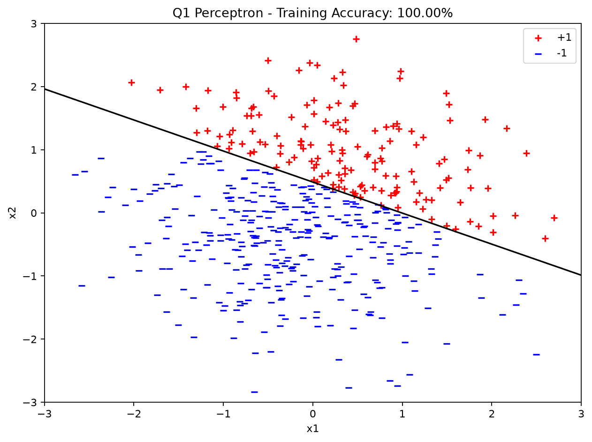
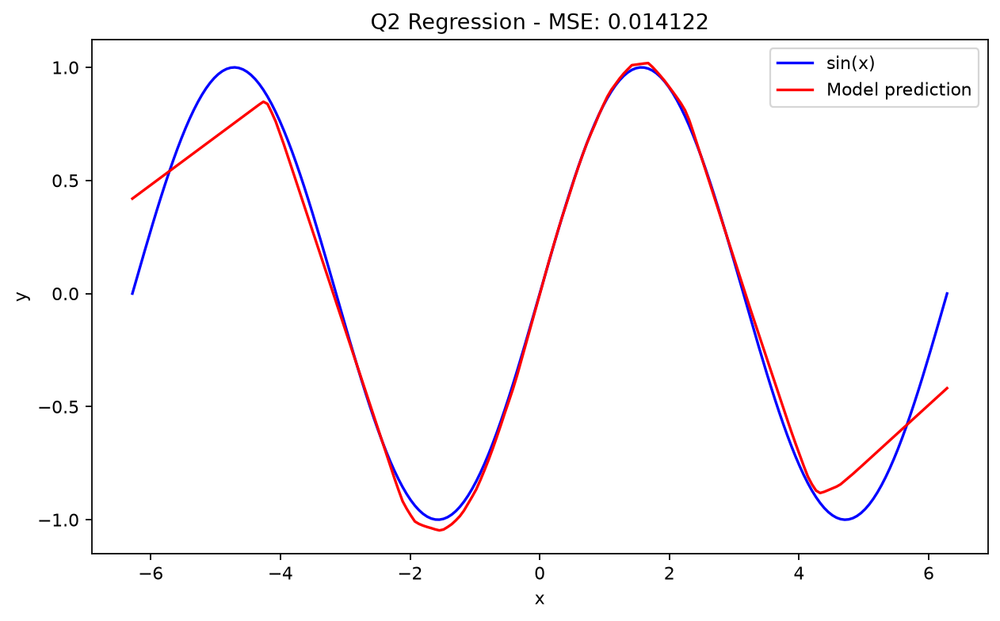
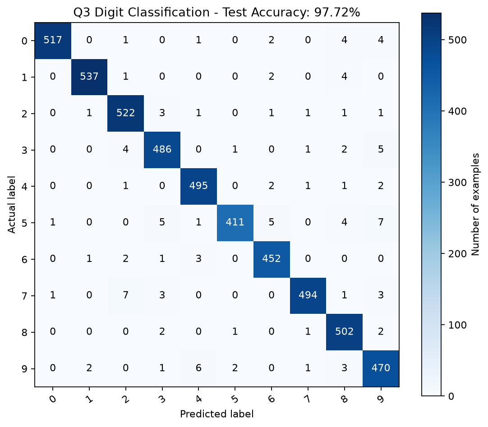
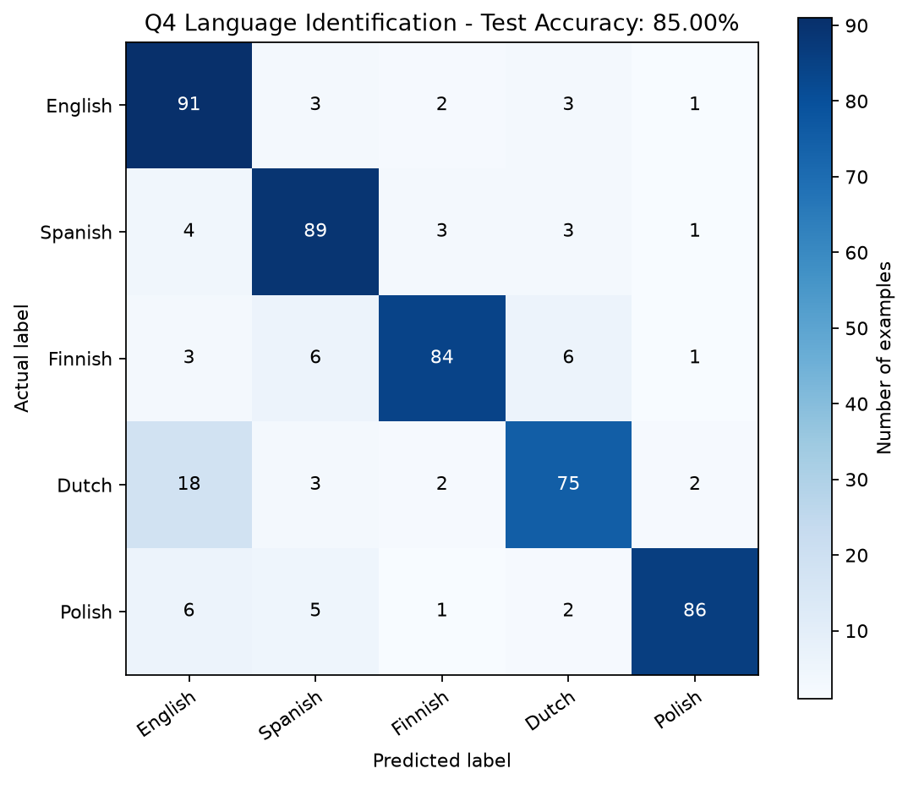
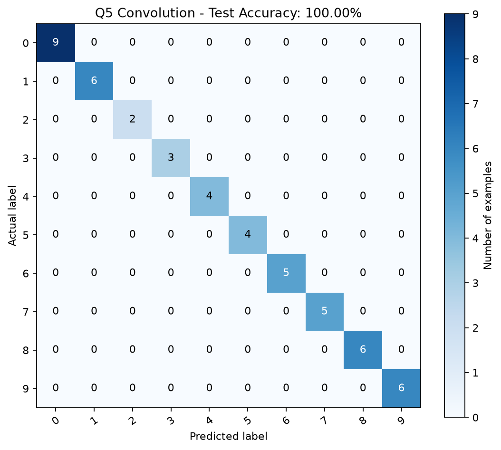

# Project 5 - Machine Learning

## Giới thiệu

Dự án cài đặt và đánh giá các mô hình học máy bằng Python và PyTorch. Sáu nội
dung chính gồm:

1. Perceptron phân loại dữ liệu hai lớp.
2. Hồi quy xấp xỉ hàm `sin(x)`.
3. Mạng neural phân loại chữ số viết tay MNIST.
4. Mạng neural nhận diện ngôn ngữ của từ.
5. Mô hình convolution phân loại chữ số.
6. Cơ chế causal self-attention.

Các file `gpt_model.py` và `chargpt.py` cung cấp phần mở rộng Character GPT.
Chương trình `chargpt.py` cần file dữ liệu `input.txt` trong thư mục dự án.

## Cấu trúc dự án

- `models.py`: định nghĩa các mô hình.
- `losses.py`: các hàm loss.
- `train.py`: các vòng lặp huấn luyện.
- `backend.py`: dataset và tiện ích cho autograder.
- `autograder.py`: bộ kiểm tra các câu 1–6.
- `generate_results.py`: chạy lại các mô hình và tạo ảnh kết quả.
- `data/mnist.npz`, `data/lang_id.npz`: dữ liệu cho các bài phân loại.

## Yêu cầu

- Python 3
- NumPy
- Matplotlib
- PyTorch

Cài các thư viện cần thiết:

```bash
python -m pip install numpy matplotlib torch
```

## Chạy kiểm tra

Từ thư mục dự án, chạy toàn bộ autograder:

```bash
python autograder.py --no-graphics
```

Tùy chọn `--no-graphics` tắt các cửa sổ đồ họa trong lúc kiểm tra. Kết quả
được in trong terminal. Lần chạy gần nhất đạt **25/25** điểm:

| Câu | Nội dung | Điểm |
|---|---|---:|
| 1 | Perceptron | 5/5 |
| 2 | Regression | 5/5 |
| 3 | Digit Classification | 5/5 |
| 4 | Language Identification | 5/5 |
| 5 | Convolution | 3/3 |
| 6 | Attention | 2/2 |

## Tạo ảnh kết quả

Chạy lệnh sau để huấn luyện lại các mô hình và tạo ảnh kết quả cho câu 1–5:

```bash
python generate_results.py
```

Script lưu các file `question-1-result.png` đến `question-5-result.png` ngay
trong thư mục dự án. Quá trình huấn luyện có thể mất vài phút. Câu 6 vẫn được
kiểm tra bằng autograder nhưng không tạo ảnh kết quả.

Kết quả tham khảo của lần chạy gần nhất:

- Câu 1: độ chính xác huấn luyện **100%**.
- Câu 2: MSE **0.014122**.
- Câu 3: độ chính xác test **97.72%**.
- Câu 4: độ chính xác test **85.00%**.
- Câu 5: độ chính xác test **100%**.

### Câu 1 - Perceptron



### Câu 2 - Regression



### Câu 3 - Digit Classification



### Câu 4 - Language Identification



### Câu 5 - Convolution



## Mã nguồn trên GitHub

Repository của dự án:
[GiuaKy-TriTueNhanTao/Project-5-Machine-Learning](https://github.com/GiuaKy-TriTueNhanTao/Project-5-Machine-Learning)
